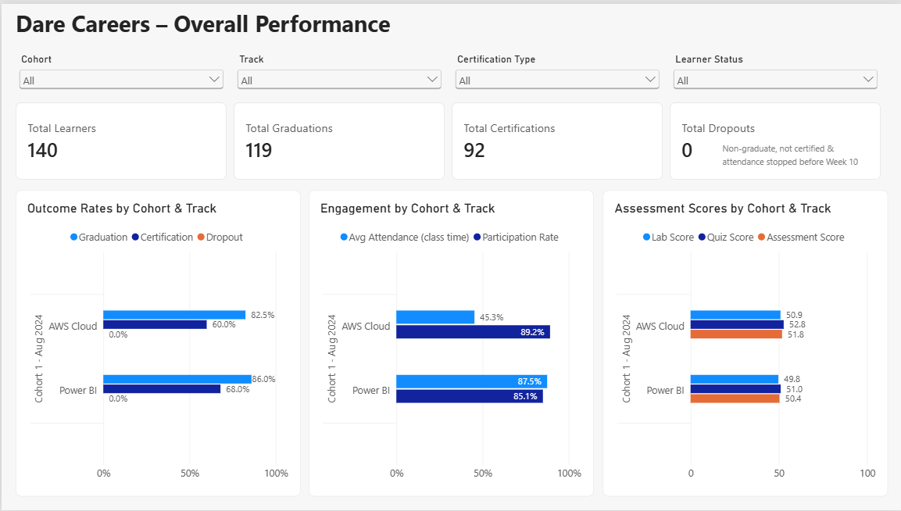
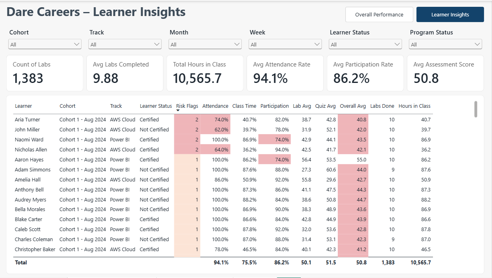
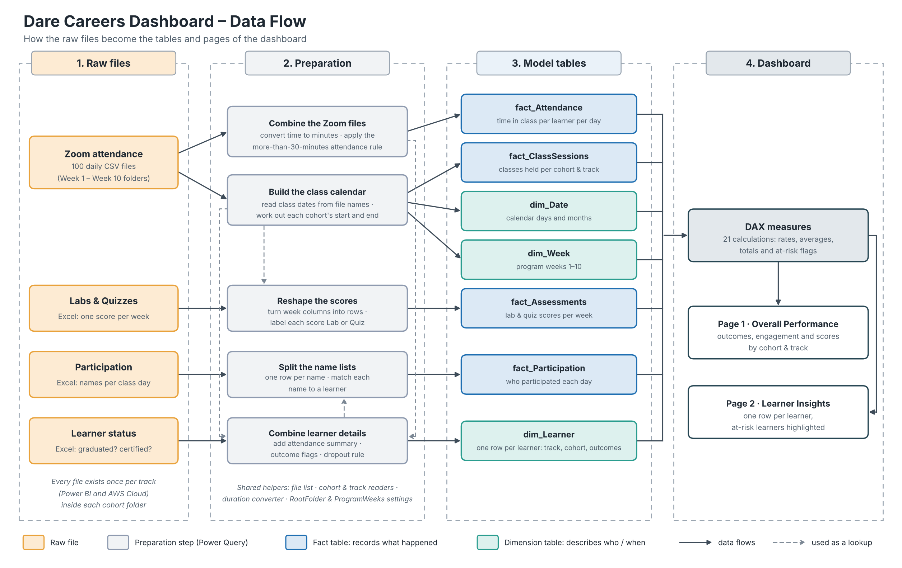
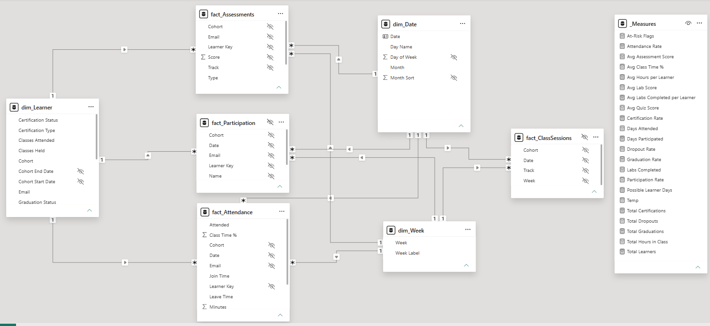

# Dare Careers – Learner Progress & Performance Dashboard

A Power BI dashboard that helps Dare Careers follow how its learners are doing: who attends class,
who takes part, how they score on labs and quizzes, and who graduates, gets certified or drops out.
It covers the **August–October 2024 cohort** (140 learners across two tracks: **Power BI** and
**AWS Cloud**) and is built so that future cohorts can be added without rebuilding anything.

---

## Project Deliverables

| Deliverable | What it is |
|---|---|
| [Power BI dashboard](Dashboard/Dare-Careers-Dashboard.pbip) | The working two-page report (open with Power BI Desktop) |
| [Page 1 – Overall Performance](Docs/screenshots/page1-overall-performance.png) | Screenshot: program-level results |
| [Page 2 – Learner Insights](Docs/screenshots/page2-learner-insights.png) | Screenshot: learner-by-learner view with at-risk flags |
| [Stakeholder report (PDF)](Docs/Dare-Careers-Stakeholder-Report.pdf) | 7-slide summary of findings and recommendations for non-technical readers |
| [Project brief](Project-Description.md) | The original project description and requirements |
| [Data-flow diagram](Docs/data-flow-diagram.png) | How the raw files become the dashboard |
| [Data model](Docs/screenshots/data-model.png) | How the tables are connected |
| [Data dictionary](Docs/data-dictionary.md) | Every source file, table and column explained |
| [Measures (calculations)](DAX/measures.md) | Every calculation, the business rules behind it and the checked results |
| [Data preparation code](Power%20Query/) | The Power Query code that cleans and shapes the data |

---

## Table of Contents

1. [About the project](#1-about-the-project)
2. [The dashboard](#2-the-dashboard)
3. [Key findings](#3-key-findings)
4. [Recommendations](#4-recommendations)
5. [How the data flows](#5-how-the-data-flows)
6. [The tables explained](#6-the-tables-explained)
7. [Rules and definitions](#7-rules-and-definitions)
8. [How the requirements were met](#8-how-the-requirements-were-met)
9. [Checking the numbers](#9-checking-the-numbers)
10. [Repository structure](#10-repository-structure)
11. [How to open and update the dashboard](#11-how-to-open-and-update-the-dashboard)
12. [Assumptions and limitations](#12-assumptions-and-limitations)
13. [Tools used](#13-tools-used)

---

## 1. About the project

Dare Careers runs 10-week training programs in **Power BI** and **AWS Cloud**. Classes happen live on
Zoom every weekday evening (6–8 PM). During each program, the team collects four kinds of data:

- **Zoom attendance:** who joined each class and for how long
- **Participation:** who actively took part in each class
- **Labs and quizzes:** a score out of 100 for every learner, every week
- **Learner status:** whether each learner graduated and whether they got certified

This data was spread across more than a hundred separate files, in two different formats, with no
single place to see how learners were doing. The goal of this project was to bring it all together
into one dashboard that:

- gives **program stakeholders** a quick overview of results, and
- gives **trainers and program managers** a detailed view of each learner, so they can spot who needs help.

---

## 2. The dashboard

The report has two pages. Buttons in the top-right corner switch between them.

### Page 1 – Overall Performance



A one-glance summary for stakeholders:

- **Four headline numbers:** total learners, graduations, certifications and dropouts
- **Outcome rates:** graduation, certification and dropout rates for each cohort and track
- **Engagement:** average share of class time attended, and average participation
- **Assessment scores:** average lab, quiz and overall scores

Filters at the top narrow everything down by **Cohort**, **Track**, **Certification Type** and
**Learner Status** (certified or not).

### Page 2 – Learner Insights



A working page for trainers:

- **Six summary numbers:** labs completed, average labs per learner, total hours in class, and average
  attendance, participation and assessment score
- **A learner table** with one row per learner: their track, certification status, attendance,
  participation, scores and labs completed
- **Risk Flags:** each learner gets 0–3 warning signs (low attendance, low participation, low scores).
  The table is sorted so learners with the most warning signs appear at the top, and problem values
  are shaded red

Filters narrow the page by **Cohort**, **Track**, **Month**, **Week**, **Learner Status** and
**Program Status** (ongoing or completed). **Clicking a learner's row** updates the six summary
numbers to show just that learner.

The Cohort, Track and Learner Status filters are shared between the two pages, so a selection made on
one page carries over to the other.

---

## 3. Key findings

| | Power BI | AWS Cloud | Whole cohort |
|---|---|---|---|
| Learners | 100 | 40 | **140** |
| Graduated | 86% | 82.5% | **85%** |
| Certified | 68% | 60% | **66%** |
| Dropped out | 0% | 17.5% | **5%** (7 learners) |
| Classes attended | 100% | 79% | **94%** |
| Share of class time spent in class | 87.5% | 45% | **75.5%** |
| Participation | 85% | 89% | **86%** |
| Average score (out of 100) | 50.4 | 51.8 | **50.8** |

1. **Most learners finished the program.** 85% graduated and only 5% dropped out.
2. **Graduating didn't always lead to certification.** 27 learners graduated but did not get certified
   (18 Power BI, 9 AWS Cloud), nearly 1 in 4 graduates.
3. **AWS Cloud learners show up, but often leave early.** They attended 79% of classes but stayed for only
   about 69 of the 120 minutes, compared with 105 minutes on Power BI. All 7 dropouts came from this track.
4. **Learners do the work, but scores sit at the halfway mark.** 99% of labs were handed in, yet the
   average score is about 51 out of 100 on both tracks, even with Power BI's perfect attendance.
5. **Low scores are the most common warning sign.** 32 learners average below 45; 4 learners show two
   warning signs at once (3 AWS Cloud, 1 Power BI).

---

## 4. Recommendations

1. **Turn graduates into certified professionals:** offer exam preparation or vouchers to the 27
   graduates without certification.
2. **Find out why AWS Cloud learners leave early:** ask about session length, timing and pace, and test
   a change such as shorter blocks with breaks.
3. **Support learning, not just attendance:** give extra help to learners averaging below 45 and check
   that assessment difficulty matches what is taught.
4. **Use the dashboard every week:** trainers review Learner Insights weekly and follow up early with
   anyone showing two warning signs.

**Next step:** agree an official pass mark and attendance target, so the warning signs match
Dare Careers' own standards.

The full story is in the [stakeholder report](Docs/Dare-Careers-Stakeholder-Report.pdf).

---

## 5. How the data flows



The diagram reads from left to right in four stages:

1. **Raw files:** the original Zoom, participation, score and status files, exactly as received.
   They are never edited by hand.
2. **Preparation:** Power BI's built-in data-preparation tool (Power Query) combines and cleans the
   files. For example, it joins 100 daily Zoom files into one list, converts every duration into
   minutes, and splits lists of names into one row per person.
3. **Model tables:** the cleaned data is organised into a small set of linked tables (explained in the
   next section).
4. **Dashboard:** calculations (written in Power BI's formula language, DAX) turn those tables into the
   numbers and charts on the two report pages.

**Dashed arrows** show where one step borrows information from another. For example, the learner list
borrows attendance figures from the Zoom data, because deciding whether someone dropped out depends on
whether they missed classes.

---

## 6. The tables explained

The model uses two kinds of table:

- **Fact tables** record **things that happened**: a learner attended a class, took part, or received a score.
  They have many rows.
- **Dimension tables** **describe** the people and dates those events relate to. They have one row per
  learner, day or week.

Every fact table links to the dimension tables. This is what allows a single filter, for example
"AWS Cloud" or "Week 3", to update every chart on the page at once.



### Dimension tables

| Table | What it holds | Why it exists |
|---|---|---|
| **dim_Learner** | One row per learner: name, email, cohort, track, graduation and certification status, attendance summary, and whether they count as a dropout | The status files only list emails. This table brings each learner's details together in one place, so every chart can be filtered by track, cohort or status |
| **dim_Date** | One row per calendar day, with its month | Lets the **Month** filter work across attendance, participation and scores at the same time |
| **dim_Week** | One row per program week (Week 1 to 10) | "Week 3" means different calendar dates for different cohorts. A separate list of program weeks lets one **Week** filter work for every cohort |

### Fact tables

| Table | What it holds | Why it exists |
|---|---|---|
| **fact_Attendance** | One row per learner per class they joined: minutes in class, and whether it counted as **attended** (more than 30 minutes) | Combines 100 daily Zoom files into one list, and applies the attendance rule in one place |
| **fact_Participation** | One row per learner per day they took part | The original files list participants' **names** in one long line per day. This table splits them into one row per person and matches each name to a learner |
| **fact_Assessments** | One row per learner, per week, per lab or quiz, with the score | The original files had one column per week. Turning these into rows makes it possible to filter scores by week or month, and to show labs and quizzes separately or together |
| **fact_ClassSessions** | One row per class that was actually held, for each cohort and track | A learner who missed a class has no Zoom record for it, so absences can't be counted directly. This table records which classes took place, so attendance can be measured fairly as *classes attended ÷ classes held* |

A further table, **_Measures**, holds all the calculations. It is not connected to anything in the
diagram because it contains no data of its own; each calculation reads directly from the tables it needs.

Full column-by-column details are in the [data dictionary](Docs/data-dictionary.md).

---

## 7. Rules and definitions

| Term | Meaning |
|---|---|
| **Attended** | A learner attended a class only if they spent **more than 30 minutes** in it. Exactly 30 minutes does not count. This rule applies to every attendance figure |
| **Attendance rate** | Classes attended ÷ classes held |
| **Share of class time** | Minutes spent in attended classes ÷ total class minutes available (120 per class) |
| **Participation rate** | Days a learner took part ÷ classes held |
| **Lab completed** | A lab with a score above 0. A score of 0 is treated as not submitted (it still counts in average scores) |
| **Dropout** | A learner who meets **all three** conditions: did not graduate, was not certified, **and** missed at least one class (no-show or 30 minutes or less). This definition was set by the data provider |
| **Warning signs (Risk Flags)** | Attendance below 75%, participation below 75%, or an average score below 45. These thresholds are working assumptions and are easy to change |
| **Cohort** | A group of learners who started together. The current data is one cohort (Aug 2024) with two tracks |
| **Certification type** | AWS or Power BI, matching the learner's track |

The reasoning behind each rule is documented in [DAX/measures.md](DAX/measures.md).

---

## 8. How the requirements were met

### Page 1 – Overall Performance

| Requirement | Where it is |
|---|---|
| Graduation, certification and dropout rates | *Outcome Rates* chart |
| Average attendance (share of class time) and average participation | *Engagement* chart |
| Average assessment scores | *Assessment Scores* chart (labs, quizzes and overall) |
| Total Learners, Graduations, Certifications, Dropouts | Four cards along the top |
| Filters: Cohort, Track, Certification Type, Learner Status | Dropdown filters along the top |

The six requested bar charts were grouped into three charts, one per unit of measure (rates, engagement
percentages and scores), so every metric is shown while keeping the page readable.

### Page 2 – Learner Insights

| Requirement | Where it is (card label) |
|---|---|
| Learner table with track, attendance, participation and scores | Learner table |
| Count of Labs | *Count of Labs* |
| Average Labs Completed | *Avg Labs Completed* |
| Total Hours Spent in Class | *Total Hours in Class* |
| Average Attendance Rate | *Avg Attendance Rate* |
| Average Participation Rate | *Avg Participation Rate* |
| Average Assessment Scores | *Avg Assessment Score* |
| Filters: Cohort, Track, Month, Week, Learner Status, Program Status | Dropdown filters along the top |

Some card labels are shortened (for example "Avg" for "Average") so they fit on the card without being cut off.

### Additional instructions

| Requirement | How it was handled |
|---|---|
| 30-minute attendance rule | Applied once during data preparation and used by every attendance figure |
| Clean, structured data | All cleaning is automated in Power Query; the raw files are untouched |
| Averages and totals at learner and cohort level | Every calculation works for the whole program, a cohort, a track, a week, a month or a single learner |
| Relationships between attendance, participation, labs, quizzes and status | See the [data model](Docs/screenshots/data-model.png) |
| Room for future cohorts | Adding a cohort only requires adding a folder (see [section 11](#11-how-to-open-and-update-the-dashboard)) |

---

## 9. Checking the numbers

Every figure in the dashboard was checked against calculations made independently from the raw files,
using a hidden quality-check page inside the report. Some examples:

| Check | Expected | Dashboard |
|---|---|---|
| Total learners | 140 | ✅ 140 |
| Graduations / certifications | 119 / 92 | ✅ 119 / 92 |
| Days of participation | 6,037 | ✅ 6,037 |
| Labs completed | 1,383 | ✅ 1,383 |
| Average score | 50.8 | ✅ 50.8 |
| Classes that could have been attended (Week 1 only) | 700 (140 learners × 5 classes) | ✅ 700 |

The full list is in [DAX/measures.md](DAX/measures.md#validation-results).

---

## 10. Repository structure

```
Business-Intelligence-Dashboard/
├── Dashboard/
│   ├── Dare-Careers-Dashboard.pbip           ← open this in Power BI Desktop
│   ├── Dare-Careers-Dashboard.Report/        ← report pages and visuals
│   ├── Dare-Careers-Dashboard.SemanticModel/ ← tables, relationships and calculations
│   └── theme/
│       └── dare-careers-theme.json           ← colours and fonts
├── Data/                                     ← raw files, never edited by hand
│   └── Cohort 1 - Aug 2024/
│       ├── Cloud Training/                   ← AWS Cloud track
│       │   ├── Zoom Attendance/Week 1 … Week 10/
│       │   ├── labs_and_quizzes.xlsx
│       │   ├── participant_status.xlsx
│       │   └── participation.xlsx
│       └── PowerBI Training/                 ← Power BI track
│           ├── Zoom Attendance/Week 1 … Week 10/
│           ├── Labs & Quizes.xlsx
│           ├── Participation records.xlsx
│           └── Status of Participanat.xlsx
├── DAX/
│   └── measures.md                           ← every calculation, rule and check
├── Docs/
│   ├── Dare-Careers-Stakeholder-Report.pdf   ← stakeholder presentation
│   ├── data-dictionary.md                    ← every file, table and column
│   ├── data-flow-diagram.png
│   └── screenshots/
│       ├── data-model.png
│       ├── page1-overall-performance.png
│       └── page2-learner-insights.png
├── Power Query/                              ← data preparation code (one file per step)
├── Project-Description.md                    ← original brief
├── README.md
└── .gitignore
```

---

## 11. How to open and update the dashboard

### Open the dashboard

1. Install [Power BI Desktop](https://www.microsoft.com/power-platform/products/power-bi/desktop) (free, Windows).
2. Clone or download this repository.
3. Open `Dashboard/Dare-Careers-Dashboard.pbip`.
4. Go to **Home → Transform data → Edit parameters** and set **RootFolder** to the full path of the
   `Data` folder on your computer, ending with a backslash, for example
   `C:\Users\you\Business-Intelligence-Dashboard\Data\`.
5. Click **Refresh**.

### Add a new cohort

1. Create a new folder inside `Data/`, for example `Data/Cohort 2 - Jan 2025/`.
2. Inside it, add a `Cloud Training` and/or `PowerBI Training` folder with the same layout as Cohort 1.
3. Keep the Zoom files named by date (e.g. `05-Aug-2024.csv`) and keep the words "quiz",
   "participation" and "status" in the Excel file names.
4. Click **Refresh**. The new cohort appears in every filter and chart automatically.

---

## 12. Assumptions and limitations

- **The data is one cohort.** Cohort comparisons will become meaningful once more cohorts are added.
- **The warning-sign thresholds** (75% attendance, 75% participation, a score of 45) are working
  assumptions, not official Dare Careers standards.
- **A lab score of 0** is treated as "not submitted".
- **Weekly scores are dated to the Monday of their week**, so Week 9 (30 Sep – 4 Oct) counts as September
  when filtering by month.
- **Classes are assumed to run 6–8 PM (120 minutes)** on every day a Zoom file exists.
- **Power BI learners had 100% attendance.** This is what the data shows; it is unusual and may be worth
  confirming with the data provider.

---

## 13. Tools used

- **Power BI Desktop:** report, data model and calculations
- **Power Query (M language):** data cleaning and preparation
- **DAX:** calculations such as rates, averages and warning signs
- **Git and GitHub:** version control, using Power BI's text-based project format (`.pbip`) so changes can be tracked
- **PowerPoint:** stakeholder report